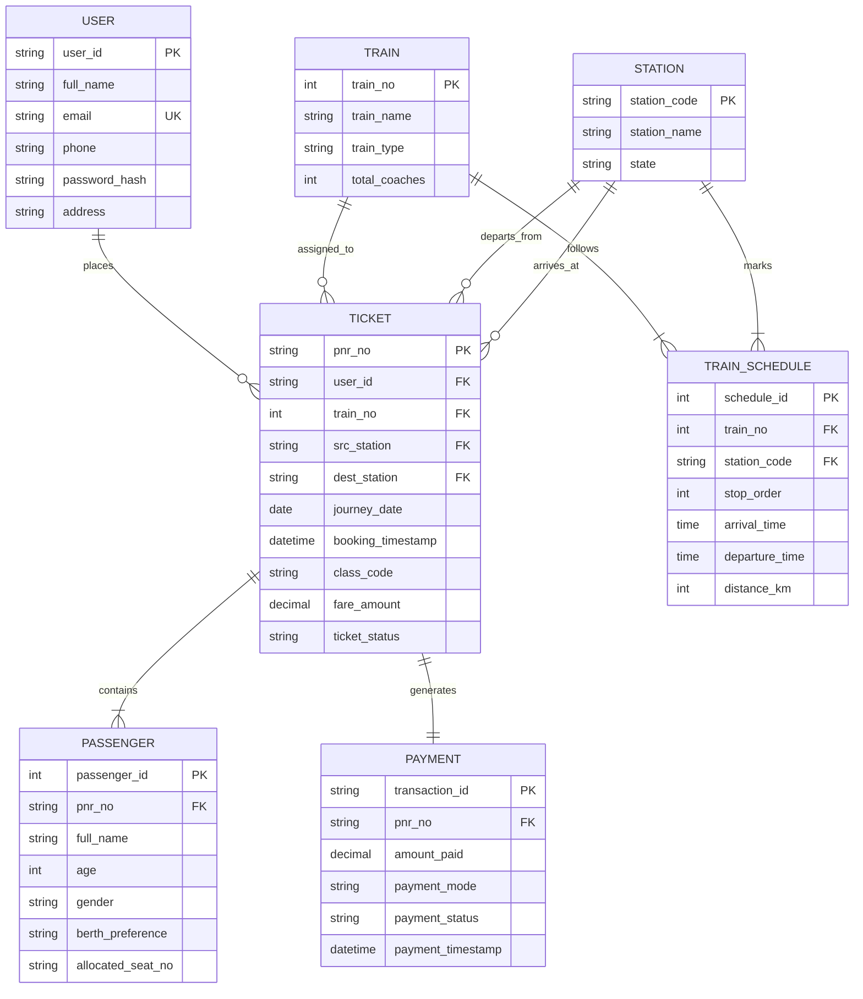

# Comprehensive Database Design Report: Railway Reservation System (RRS)

---

## 1. Executive Summary & Problem Definition

The **Railway Reservation System (RRS)** is a mission-critical, high-concurrency database application designed to manage passenger railway logistics, ticketing operations, route planning, seat inventory, and revenue accounting. 

Manual or loosely coupled reservation mechanisms often encounter concurrency anomalies such as double-booking, data redundancy, and inconsistent state tracking across multi-stop journeys. This project report outlines a fully normalized, relational database architecture using the **Entity-Relationship (ER) model** to ensure data integrity, optimal retrieval performance, and adherence to ACID (Atomicity, Consistency, Isolation, Durability) principles.

---

## 2. System Scope & Core Requirements

### 2.1 Functional Requirements
1. **Train & Route Scheduling:** Track every train, its total coaches, and its ordered sequence of stops with precise arrival and departure timestamps.
2. **User & Account Management:** Store user profiles, authentication credentials, and historical booking logs.
3. **Passenger Ticketing:** Enable users to book a single ticket (PNR) that can accommodate multiple passengers.
4. **Inventory & Seat Allocation:** Maintain real-time availability of seats across distinct travel classes (e.g., $1\text{A}$, $2\text{A}$, $3\text{A}$, $\text{SL}$).
5. **Financial Settlements:** Record each transaction with payment gateways, capturing statuses, methods, and transaction identifiers.

### 2.2 Non-Functional & Transactional Requirements
* **Atomicity:** A reservation and its payment transaction must commit together; failure at any stage rolls back the entire seat lock.
* **Integrity:** Strict foreign key dependencies prevent orphaned passenger entries when tickets are altered.
* **Concurrency:** Isolation levels must prevent dirty reads and non-repeatable reads during rapid seat status checks.

---

## 3. Entity-Relationship (ER) Architecture

### 3.1 Identified Entities & Attribute Classification

| Entity | Primary Key (PK) | Foreign Key(s) (FK) | Additional Attributes | Attribute Types |
| :--- | :--- | :--- | :--- | :--- |
| **User** | `user_id` | *None* | `name`, `email`, `phone`, `password_hash`, `city`, `pincode` | Composite (`city`, `pincode`), Unique (`email`) |
| **Train** | `train_no` | *None* | `train_name`, `train_type`, `source_station_code`, `destination_station_code` | Simple, Single-valued |
| **Station** | `station_code` | *None* | `station_name`, `division`, `state` | Simple |
| **Train_Schedule** *(Weak/Associative)* | `schedule_id` | `train_no`, `station_code` | `stop_order`, `arrival_time`, `departure_time`, `distance_km` | Composite bridge, Monotonically increasing |
| **Ticket** | `pnr_no` | `user_id`, `train_no`, `src_station`, `dest_station` | `booking_timestamp`, `journey_date`, `class_code`, `fare_amount`, `ticket_status` | Transactional, High-read/write |
| **Passenger** | `passenger_id` | `pnr_no` | `full_name`, `age`, `gender`, `berth_preference`, `allocated_seat_no` | Multi-record per ticket |
| **Payment** | `transaction_id`| `pnr_no` | `payment_mode`, `amount_paid`, `payment_status`, `payment_timestamp` | Financial audit |

---

### 3.2 Cardinality & Structural Relationships

1. **User to Ticket ($1 : N$):** A single user may make multiple bookings over time ($0 \dots N$), but each ticket belongs strictly to one user account ($1 \dots 1$).
2. **Ticket to Passenger ($1 : N$):** A ticket encompasses $1$ to $6$ passenger seats ($1 \dots 6$). Each passenger record belongs exclusively to one PNR ($1 \dots 1$).
3. **Train to Train_Schedule ($1 : N$):** A train has multiple scheduled halts ($2 \dots N$); each halt belongs to one specific train ($1 \dots 1$).
4. **Station to Train_Schedule ($1 : N$):** A station appears in multiple train schedules ($0 \dots N$); each schedule entry references exactly one station ($1 \dots 1$).
5. **Ticket to Payment ($1 : 1$ or $1 : N$):** A confirmed ticket maps directly to its payment transaction. Multiple rows can exist if partial refunds or chargebacks occur.
6. **Train to Ticket ($1 : N$):** A train serves many ticket reservations over different calendar dates.

---

### 3.3 Visual ER Diagram (Mermaid Notation)



---

## 4. Normalized Relational Schema (Third Normal Form - 3NF)

To eliminate update, insertion, and deletion anomalies, the schema is decomposed into 3NF:

* **`Users`** (`user_id` [PK], `full_name`, `email` [UQ], `phone`, `password_hash`, `address`, `created_at`)
* **`Stations`** (`station_code` [PK], `station_name`, `state`)
* **`Trains`** (`train_no` [PK], `train_name`, `train_type`, `total_coaches`)
* **`Train_Schedules`** (`schedule_id` [PK], `train_no` [FK $\rightarrow$ `Trains`], `station_code` [FK $\rightarrow$ `Stations`], `stop_order`, `arrival_time`, `departure_time`, `distance_km`)  
  * *Unique Constraint:* `UNIQUE(train_no, stop_order)`
* **`Tickets`** (`pnr_no` [PK], `user_id` [FK $\rightarrow$ `Users`], `train_no` [FK $\rightarrow$ `Trains`], `src_station` [FK $\rightarrow$ `Stations`], `dest_station` [FK $\rightarrow$ `Stations`], `journey_date`, `booking_timestamp`, `class_code`, `fare_amount`, `ticket_status`)
* **`Passengers`** (`passenger_id` [PK], `pnr_no` [FK $\rightarrow$ `Tickets` ON DELETE CASCADE], `full_name`, `age`, `gender`, `berth_preference`, `allocated_seat_no`)
* **`Payments`** (`transaction_id` [PK], `pnr_no` [FK $\rightarrow$ `Tickets`], `amount_paid`, `payment_mode`, `payment_status`, `payment_timestamp`)

---

## 5. SQL DDL Implementation

```sql
CREATE TABLE Users (
    user_id VARCHAR(36) PRIMARY KEY,
    full_name VARCHAR(100) NOT NULL,
    email VARCHAR(100) NOT NULL UNIQUE,
    phone VARCHAR(15) NOT NULL,
    password_hash VARCHAR(255) NOT NULL,
    address TEXT,
    created_at TIMESTAMP DEFAULT CURRENT_TIMESTAMP
);

CREATE TABLE Stations (
    station_code VARCHAR(10) PRIMARY KEY,
    station_name VARCHAR(100) NOT NULL,
    state VARCHAR(50) NOT NULL
);

CREATE TABLE Trains (
    train_no INT PRIMARY KEY,
    train_name VARCHAR(100) NOT NULL,
    train_type VARCHAR(30) NOT NULL,
    total_coaches INT NOT NULL CHECK (total_coaches > 0)
);

CREATE TABLE Train_Schedules (
    schedule_id INT AUTO_INCREMENT PRIMARY KEY,
    train_no INT NOT NULL,
    station_code VARCHAR(10) NOT NULL,
    stop_order INT NOT NULL,
    arrival_time TIME,
    departure_time TIME,
    distance_km INT NOT NULL,
    FOREIGN KEY (train_no) REFERENCES Trains(train_no) ON DELETE CASCADE,
    FOREIGN KEY (station_code) REFERENCES Stations(station_code),
    UNIQUE (train_no, stop_order)
);

CREATE TABLE Tickets (
    pnr_no VARCHAR(10) PRIMARY KEY,
    user_id VARCHAR(36) NOT NULL,
    train_no INT NOT NULL,
    src_station VARCHAR(10) NOT NULL,
    dest_station VARCHAR(10) NOT NULL,
    journey_date DATE NOT NULL,
    booking_timestamp TIMESTAMP DEFAULT CURRENT_TIMESTAMP,
    class_code VARCHAR(5) NOT NULL,
    fare_amount DECIMAL(10, 2) NOT NULL CHECK (fare_amount >= 0),
    ticket_status ENUM('CONFIRMED', 'RAC', 'WAITLIST', 'CANCELLED') NOT NULL,
    FOREIGN KEY (user_id) REFERENCES Users(user_id),
    FOREIGN KEY (train_no) REFERENCES Trains(train_no),
    FOREIGN KEY (src_station) REFERENCES Stations(station_code),
    FOREIGN KEY (dest_station) REFERENCES Stations(station_code)
);

CREATE TABLE Passengers (
    passenger_id INT AUTO_INCREMENT PRIMARY KEY,
    pnr_no VARCHAR(10) NOT NULL,
    full_name VARCHAR(100) NOT NULL,
    age INT NOT NULL CHECK (age > 0 AND age <= 120),
    gender ENUM('M', 'F', 'O') NOT NULL,
    berth_preference VARCHAR(15),
    allocated_seat_no VARCHAR(10),
    FOREIGN KEY (pnr_no) REFERENCES Tickets(pnr_no) ON DELETE CASCADE
);

CREATE TABLE Payments (
    transaction_id VARCHAR(50) PRIMARY KEY,
    pnr_no VARCHAR(10) NOT NULL,
    amount_paid DECIMAL(10, 2) NOT NULL CHECK (amount_paid >= 0),
    payment_mode ENUM('CREDIT_CARD', 'DEBIT_CARD', 'UPI', 'NET_BANKING') NOT NULL,
    payment_status ENUM('SUCCESS', 'FAILED', 'REFUNDED') NOT NULL,
    payment_timestamp TIMESTAMP DEFAULT CURRENT_TIMESTAMP,
    FOREIGN KEY (pnr_no) REFERENCES Tickets(pnr_no)
);
```

---

## 6. 20 Analytical & Operational SQL Query Questions (With Solutions)

Below is a curated set of 20 database query problems designed to test operations from simple record fetching to complex joins, aggregations, window functions, and subqueries.

### Section A: Basic Queries & Filtering

#### Q1: Retrieve all trains categorized as 'Superfast'.
```sql
SELECT train_no, train_name 
FROM Trains 
WHERE train_type = 'Superfast';
```

#### Q2: List all passengers who are senior citizens (age $\ge 60$).
```sql
SELECT passenger_id, full_name, age, gender, pnr_no 
FROM Passengers 
WHERE age >= 60 
ORDER BY age DESC;
```

#### Q3: Find all tickets that are currently in 'WAITLIST' status.
```sql
SELECT pnr_no, train_no, journey_date, class_code 
FROM Tickets 
WHERE ticket_status = 'WAITLIST';
```

#### Q4: Retrieve all stations located in the state of 'Maharashtra'.
```sql
SELECT station_code, station_name 
FROM Stations 
WHERE state = 'Maharashtra';
```

#### Q5: List all bookings made within the last 7 days.
```sql
SELECT pnr_no, user_id, fare_amount, booking_timestamp 
FROM Tickets 
WHERE booking_timestamp >= NOW() - INTERVAL 7 DAY;
```

---

### Section B: Joins & Relational Lookups

#### Q6: Retrieve full passenger details along with the train name and journey date for a specific PNR ('PNR1000001').
```sql
SELECT 
    p.full_name AS passenger_name,
    p.age,
    p.allocated_seat_no,
    t.train_name,
    tk.journey_date,
    tk.ticket_status
FROM Passengers p
JOIN Tickets tk ON p.pnr_no = tk.pnr_no
JOIN Trains t ON tk.train_no = t.train_no
WHERE tk.pnr_no = 'PNR1000001';
```

#### Q7: Display the complete route schedule (station name, stop number, arrival, departure) for Train number 12951 in sequence.
```sql
SELECT 
    s.stop_order,
    st.station_name,
    s.arrival_time,
    s.departure_time,
    s.distance_km
FROM Train_Schedules s
JOIN Stations st ON s.station_code = st.station_code
WHERE s.train_no = 12951
ORDER BY s.stop_order ASC;
```

#### Q8: Find all users who have tickets booked for travel originating from station code 'NDLS'.
```sql
SELECT DISTINCT 
    u.user_id, 
    u.full_name, 
    u.email, 
    tk.pnr_no, 
    tk.journey_date
FROM Users u
JOIN Tickets tk ON u.user_id = tk.user_id
WHERE tk.src_station = 'NDLS';
```

#### Q9: Show all payments made via 'UPI' that were successfully processed, including the ticket's journey date and user's full name.
```sql
SELECT 
    p.transaction_id,
    u.full_name AS booked_by,
    p.amount_paid,
    tk.pnr_no,
    tk.journey_date
FROM Payments p
JOIN Tickets tk ON p.pnr_no = tk.pnr_no
JOIN Users u ON tk.user_id = u.user_id
WHERE p.payment_mode = 'UPI' 
  AND p.payment_status = 'SUCCESS';
```

#### Q10: Find trains that halt at both 'BCT' (Mumbai Central) and 'NDLS' (New Delhi).
```sql
SELECT s1.train_no
FROM Train_Schedules s1
JOIN Train_Schedules s2 ON s1.train_no = s2.train_no
WHERE s1.station_code = 'BCT' 
  AND s2.station_code = 'NDLS'
  AND s1.stop_order < s2.stop_order;
```

---

### Section C: Grouping, Aggregations & Analytical Metrics

#### Q11: Calculate the total revenue generated by each train, ordered from highest to lowest revenue.
```sql
SELECT 
    t.train_no,
    t.train_name,
    COALESCE(SUM(tk.fare_amount), 0.00) AS total_revenue
FROM Trains t
LEFT JOIN Tickets tk ON t.train_no = tk.train_no AND tk.ticket_status != 'CANCELLED'
GROUP BY t.train_no, t.train_name
ORDER BY total_revenue DESC;
```

#### Q12: Find the total number of passengers travelling on each booking (PNR).
```sql
SELECT 
    pnr_no, 
    COUNT(passenger_id) AS passenger_count
FROM Passengers
GROUP BY pnr_no
HAVING passenger_count > 0;
```

#### Q13: Determine the average fare spent by users grouped by booking class (`class_code`).
```sql
SELECT 
    class_code,
    ROUND(AVG(fare_amount), 2) AS average_fare,
    COUNT(pnr_no) AS total_bookings
FROM Tickets
WHERE ticket_status = 'CONFIRMED'
GROUP BY class_code;
```

#### Q14: Identify the top 3 stations that serve as the most frequent starting points (origins) for booked tickets.
```sql
SELECT 
    s.station_code,
    s.station_name,
    COUNT(tk.pnr_no) AS departure_count
FROM Stations s
JOIN Tickets tk ON s.station_code = tk.src_station
GROUP BY s.station_code, s.station_name
ORDER BY departure_count DESC
LIMIT 3;
```

#### Q15: Calculate the failure rate percentage for all payment attempts.
```sql
SELECT 
    ROUND((COUNT(CASE WHEN payment_status = 'FAILED' THEN 1 END) * 100.0) / COUNT(*), 2) AS failure_percentage
FROM Payments;
```

---

### Section D: Advanced Subqueries, Correlated Queries & Window Functions

#### Q16: Find users who have booked more tickets than the average ticket bookings across all registered users.
```sql
SELECT 
    user_id, 
    COUNT(pnr_no) AS total_tickets
FROM Tickets
GROUP BY user_id
HAVING COUNT(pnr_no) > (
    SELECT AVG(user_ticket_count)
    FROM (
        SELECT COUNT(pnr_no) AS user_ticket_count
        FROM Tickets
        GROUP BY user_id
    ) AS user_counts
);
```

#### Q17: List trains that have zero bookings recorded for tomorrow's date.
```sql
SELECT t.train_no, t.train_name
FROM Trains t
WHERE NOT EXISTS (
    SELECT 1 
    FROM Tickets tk 
    WHERE tk.train_no = t.train_no 
      AND tk.journey_date = CURDATE() + INTERVAL 1 DAY
);
```

#### Q18: Find the passenger who has the highest fare ticket booked (handling ties using a subquery).
```sql
SELECT 
    p.full_name AS passenger_name, 
    tk.pnr_no, 
    tk.fare_amount
FROM Passengers p
JOIN Tickets tk ON p.pnr_no = tk.pnr_no
WHERE tk.fare_amount = (
    SELECT MAX(fare_amount) 
    FROM Tickets
);
```

#### Q19: Using a Window function, rank the stop orders for each train and calculate the incremental distance traveled between consecutive stops.
```sql
SELECT 
    train_no,
    station_code,
    stop_order,
    distance_km,
    distance_km - LAG(distance_km, 1, 0) OVER (
        PARTITION BY train_no 
        ORDER BY stop_order
    ) AS distance_from_prev_stop
FROM Train_Schedules;
```

#### Q20: Find all users who have spent more than \$5,000 on tickets in total, but have experienced at least one cancelled booking.
```sql
SELECT 
    u.user_id,
    u.full_name,
    SUM(tk.fare_amount) AS total_spent
FROM Users u
JOIN Tickets tk ON u.user_id = tk.user_id
WHERE u.user_id IN (
    SELECT user_id 
    FROM Tickets 
    WHERE ticket_status = 'CANCELLED'
)
GROUP BY u.user_id, u.full_name
HAVING total_spent > 5000.00;
```

---

## 7. Conclusion & Future Extensions

This report details an enterprise-grade schema for an online Railway Reservation System. By decoupling trains, physical stations, ordered schedules, passenger entities, and financial ledgers, the architecture preserves third normal form while avoiding transaction locks on high-traffic queries.

### Suggested Extensions:
1. **Coach Layout Mapping:** Add coach-level entities (e.g., coach type, berth numbering schemas like Upper, Lower, Middle, Side Upper, Side Lower).
2. **Dynamic Pricing Tables:** Introduce a distance-and-demand rate matrix table calculating real-time fares dynamically.
3. **Waitlist Queue Pointers:** Implement an ordered queue data structure using SQL window sequences to automatically promote waitlisted passengers when cancellations occur.